# 🎧 G321 Wireless Headset Master Controller

一個因為羅技 G321 無線耳機沒有專用軟體調整EQ和監控電量而誕生的小工具，支援 Equalizer APO 的 Windows 音訊設備打造的現代化桌面音效與混音控制面板。採用 Python 與 PyQt6 開發，介面設計參考 Spotify 質感暗色系，兼具極致調音精度與系統常駐便利性。

---

## 🎯 專案動機 

市面上的許多耳機官方控制軟體往往較為笨重、佔用大量資源，且在等化器（EQ）的調整上通常缺乏足夠的精細度。
本專案的誕生是為了解決以下痛點：
1. **精準調音**：提供 0.1 dB 級距的 6 頻段等化器微調，滿足對音質與遊戲聽聲辨位有高要求的玩家。
2. **輕量化與整合性**：結合耳機主音量、麥克風獨立控制、即時頻譜與無線電量監控於同一個介面，並能完美與 Windows 系統底層音效引擎（Equalizer APO）對接。
3. **極致體驗**：支援 Windows 系統匣常駐與情境快速切換，讓日常遊戲、聽音樂與語音開會都能一鍵切換最佳音效設定。
4. **羅技 G321 無線耳機**：我買完才發現它什麼都沒有，就便宜而已 ==

---

## 🚀 功能特色 

- **🎛️ 6 頻段專業等化器**：涵蓋 60Hz 至 15KHz 頻段，支援 **0.1 dB** 精細調整，並即時寫入 Equalizer APO 設定檔。

- **🎙️ 智慧混音與麥克風控制**：可獨立即時調整麥克風輸入音量，並提供一鍵快速靜音（Mute）勾選。

- **🔋 無線電量即時監控**：背景執行緒定期抓取無線耳機連線與電量狀態。
- **📊 動態頻譜視覺化 (Audio Visualizer)**：介面底部內建即時跳動的科技感音效頻譜條(沒什麼用但很可愛)。

- **🗂️ 多情境預設模式**：內建「遊戲模式」、「音樂模式」、「語音會議」與「自定義模式」，支援即時存檔與系統匣右鍵快速切換。


---

## ⚙️ 核心技術 

- **程式語言**：Python 3.x
- **圖形介面 (GUI)**：PyQt6（結合自定義 CSS）
- **系統音效控制**：`pycaw` (Python Core Audio Windows Library) 與 `comtypes`
- **系統匣常駐**：`pystray` & `Pillow`
- **底層音效引擎**：Equalizer APO (`config.txt` 實時寫入)
- **打包工具**：PyInstaller

---

## 📌 步驟指南 

### 1. 環境需求與前置準備
- 作業系統：Windows 10 / 11
- 必須先安裝 [Equalizer APO](https://sourceforge.net/projects/equalizerapo/)，並在安裝設定器（Configurator）中勾選你的 G321 裝置或其他需改造的破耳機。安裝完成後請**重新開機**。

### 2. 安裝相依套件
將專案下載至本地後，在終端機執行以下指令安裝必要套件：
```bash
pip install -r requirements.txt
```

### 3.執行與測試
直接執行主程式：
```bash
python g321_controller.py
```

### 4.打包成獨立 .exe 執行檔
若想將其打包為不需要 Python 環境也能執行的獨立工具：
<p>開啟終端機 > cd 進該專案資料夾(G321-Audio-Controller)>打包執行檔 

```bash
pyinstaller --noconsole --onefile --icon=g321icon.ico g321_controller.py
```

### 5.開啟檔案

>開啟資料夾(G321-Audio-Controller > dist)
>
>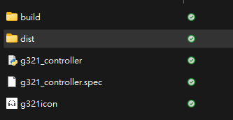

>找到 g321_controller 應用程式 (.exe) 
>
> 

>雙擊後即可在工作列隱藏的圖示中找到 G321 無線控制器 
>
>


>右鍵開啟選單即可開始操作
>
>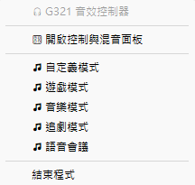


## 介面功能

### 控制面板
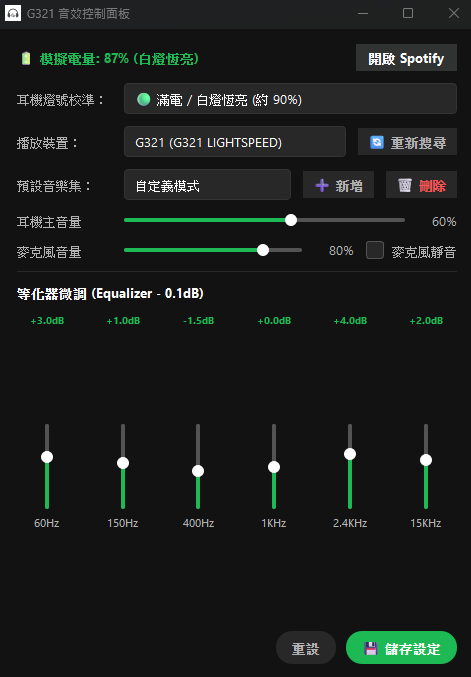

### 選擇模式
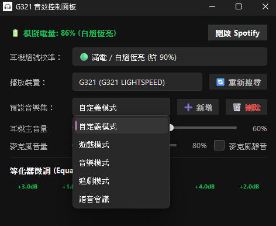

### 新增模式
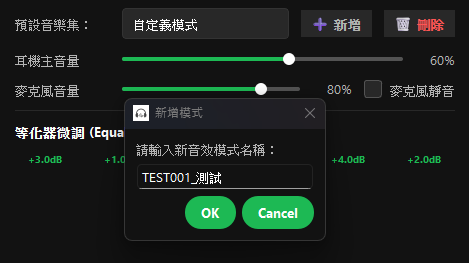

### 儲存設定
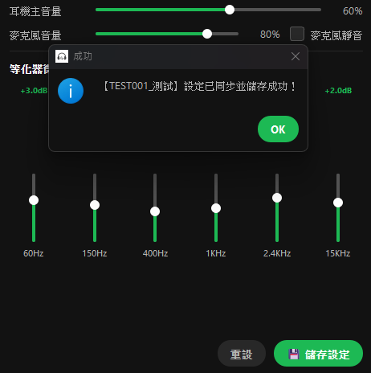

### 刪除模式
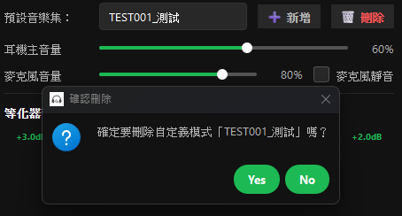

### SPOTIFY快捷鍵
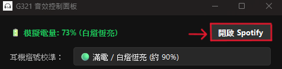

### 模擬電量
>因G321無法收集電量資訊，選擇採用模擬掉電的模式，以60秒為單位模擬掉電狀態，若需調整掉電速度可至程式碼中找到```time.sleep(60)```調整秒數

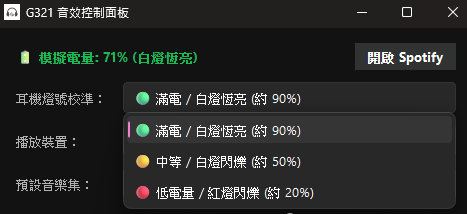
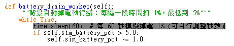

### 儲存後的設定會以json的形式存在 g321_config.json
>...\dist\g321_config.json

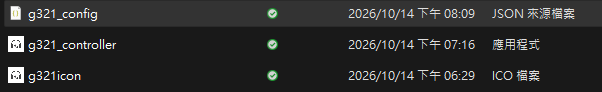

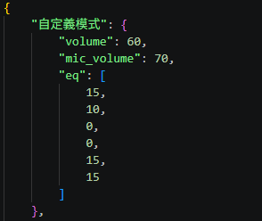

